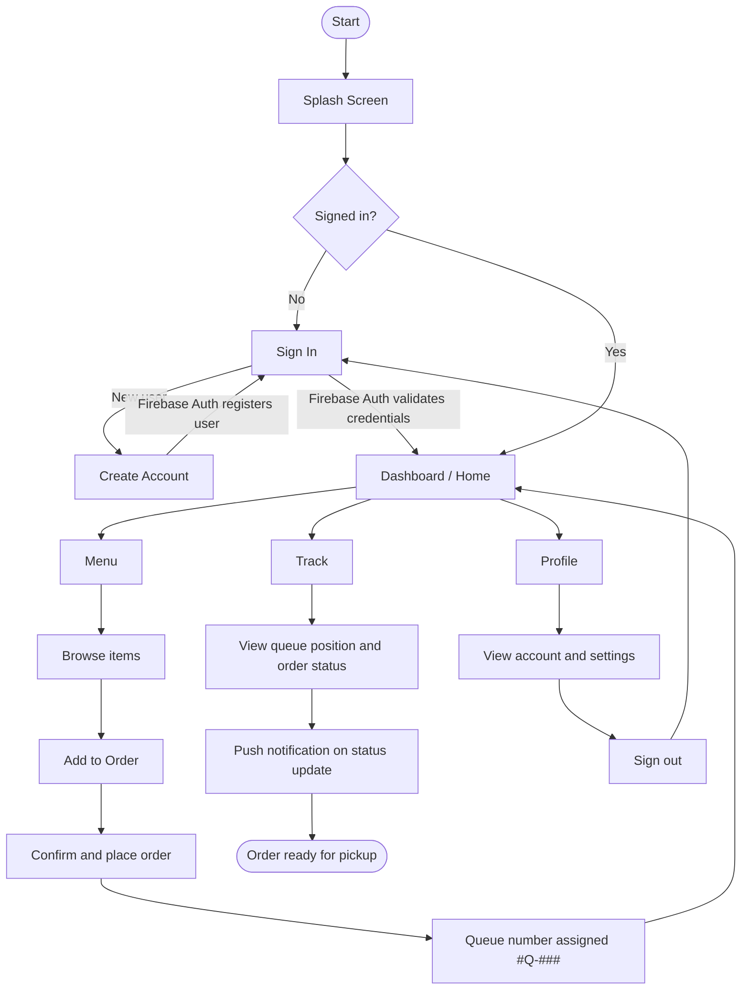
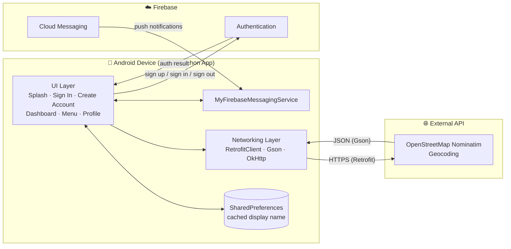

<div align="center">

# 🍗 Covy's Lechon

### Food Ordering & Queue Tracking App for Android

*Authentic. Juicy. Flavorful.*


[🎨 Figma Design](https://www.figma.com/design/Sd10VUqpIFXdh3IsPNnNbQ/Covy-s-lechon?node-id=1001-4&t=uUMMwuufwizbFQDb-1) · [💻 Repository](https://github.com/ricardoadriantan-png/Covy-s-Lechon)

</div>

---

## 📑 Table of Contents

1. [About the Project](#-about-the-project)
2. [Key Features](#-key-features)
3. [Complete Application Flow](#-complete-application-flow)
4. [Application Flowchart](#-application-flowchart)
5. [APIs, SDKs, and Integrations](#-apis-sdks-and-integrations)
6. [Integration Architecture](#-integration-architecture)
7. [Technologies Used](#-technologies-used)
8. [Project Structure](#-project-structure)
9. [Installation and Setup](#-installation-and-setup)
10. [Security and Privacy](#-security-and-privacy)
11. [Application Screens](#-application-screens)
12. [Future Improvements](#-future-improvements)
13. [Project Status](#-project-status)
14. [The Team](#-the-team)
15. [AI Disclosure](#-artificial-intelligence-ai-disclosure)

---

## 📖 About the Project

**Covy's Lechon** is a native Android mobile application MVP built for a lechon manok (roasted chicken) business in Davao City. Many local food businesses still take orders through Facebook messages and phone calls, which can lead to delayed replies, missed orders, and hard-to-track transactions. This app moves that process onto the customer's phone.

With the app, customers can browse the menu, place an order before arriving at the store, receive a **queue number**, and follow their order status through to pickup, which reduces waiting time and ordering mistakes.

This project was developed for **CC106 – Application Development and Emerging Technologies** at the **College of Information and Communications Technology (CICT), St. John Paul II College of Davao**, as a cumulative MVP project (Prelim → Midterm → Final).

### 🎯 Objectives

- Create an ordering system for lechon manok.
- Let customers browse the available products and place orders online.
- Let customers follow the status of their orders.
- Verify orders before processing to avoid ordering mistakes.
- Make pickup convenient and reduce manual transactions.

### 👥 Target Users

| User | How they benefit |
| --- | --- |
| **Customers** | Convenient menu access, easy ordering, queue number, and order tracking. |
| **Business owner / staff** | Fewer manual transactions, better order management, and an online presence. |

> **Scope note:** The MVP is built around **store pickup**. Third-party delivery integration is outside the current scope.

---

## ✨ Key Features

| Feature | Description |
| --- | --- |
| 🚀 **Splash Screen** | Branded startup screen that leads into the app. |
| 🔐 **Authentication** | Email-and-password sign-up and sign-in powered by Firebase Authentication. |
| 🏠 **Personalized Dashboard** | Greets the customer by name (`WELCOME, [USER NAME]!`) and brings order info together in one place. |
| 🔢 **Queue Number Tracking** | Customers receive a queue number (`#Q-###`) when an order is placed and see a "Now Serving" indicator showing how many orders are ahead of them. |
| ✅ **Order Verification Card** | Shows the verification status of the customer's order before it is processed. |
| 🍽️ **Digital Menu** | Lechon Manok (Whole), Lechon Manok (Half), Paa, Wings, and Chicken Inasal, with product images and an **Add to Order** button. |
| 🎁 **Loyalty & Delivery Status Widgets** | Dashboard widgets for loyalty points and order progress. |
| 🔔 **Push Notifications** | Firebase Cloud Messaging service for order status and queue updates. |
| 📍 **Address Geocoding** | Forward and reverse address lookup through the OpenStreetMap Nominatim API. |
| 👤 **Profile** | Account overview with customer name, personal information, settings, and secure sign-out. |
| 🧭 **Bottom Navigation** | Cream-themed bar with soft-orange active pills for switching between **Home**, **Menu**, **Track**, and **Profile**. |

---

## 🔄 Complete Application Flow

1. **Launch** – The app opens on the **Splash Screen** showing the Covy's Lechon branding.
2. **Authentication** – The user lands on **Sign In**.
   - *Returning user:* enters email and password, which Firebase Authentication verifies.
   - *New user:* taps **Create Account**, enters name, email, password, and password confirmation, and is registered through Firebase Authentication. The display name is cached locally in `SharedPreferences`.
3. **Dashboard (Home)** – After login, the user sees a personalized welcome banner, the order verification card, queue information, delivery status progress, and loyalty points.
4. **Browse the Menu** – From the bottom navigation, the user opens **Menu** and views the available lechon manok products.
5. **Build an Order** – The user taps **Add to Order** on an item and gets instant toast feedback (e.g., *"Added Lechon Manok (Half) to Order!"*).
6. **Place the Order** – The user confirms the order from the dashboard and receives a queue number (*"Order Placed! Your Queue Number is #Q-###"*).
7. **Track the Order** – The user checks their queue position (*"Now Serving: #Q-### (N ahead of you)"*) and the order status, and receives push notifications for updates.
8. **Pick Up** – When the order is ready, the customer picks it up at the Covy's Lechon store.
9. **Manage Profile** – The user can review account details under **Profile** and **sign out** securely.

---

## 🗺️ Application Flowchart



---

## 🔌 APIs, SDKs, and Integrations

| Integration | Type | Purpose in the app |
| --- | --- | --- |
| **Firebase Authentication** | SDK | Secure email/password registration and login. |
| **Firebase Cloud Messaging (FCM)** | SDK | Push notifications for order and queue updates (handled by `MyFirebaseMessagingService`). |
| **OpenStreetMap Nominatim** | REST API | Forward and reverse geocoding for customer addresses (`https://nominatim.openstreetmap.org/`). |
| **Retrofit 2.9.0** | Library | Type-safe HTTP client used to call the Nominatim API. |
| **Gson Converter** | Library | JSON parsing of API responses. |
| **OkHttp 4.x + Logging Interceptor** | Library | HTTP layer and request/response logging for debugging. |
| **Material Components (Material 3)** | UI library | Modern, consistent UI components and theming. |
| **Android `SharedPreferences`** | Platform API | Local caching of the customer's display name. |

**App permissions requested:** `INTERNET`, `ACCESS_NETWORK_STATE`, `POST_NOTIFICATIONS`, `WAKE_LOCK`.

---

## 🏗️ Integration Architecture



> **Planned:** a real-time database layer (see [Future Improvements](#-future-improvements)) will store orders, queue numbers, and verification status, and sync them across customer and staff devices.

---

## 🧰 Technologies Used

| Category | Technology |
| --- | --- |
| **IDE** | Android Studio |
| **Language** | Java |
| **Platform** | Android SDK (Min SDK 24, Target SDK 37) |
| **UI** | XML layouts, Material 3 (`com.google.android.material`), ConstraintLayout |
| **Authentication** | Firebase Authentication (Firebase BoM 35.0.0) |
| **Messaging** | Firebase Cloud Messaging |
| **Networking** | Retrofit 2.9.0, Gson Converter, OkHttp 4.x Logging Interceptor |
| **Geocoding** | OpenStreetMap Nominatim API |
| **Build System** | Gradle (Kotlin DSL: `build.gradle.kts`) |
| **UI/UX Design** | [Figma](https://www.figma.com/design/Sd10VUqpIFXdh3IsPNnNbQ/Covy-s-lechon?node-id=1001-4&t=uUMMwuufwizbFQDb-1) |
| **Version Control** | Git & GitHub |

**Why native Android?** Most of the target customers use Android smartphones. A native build offers better performance and smoother device integration (such as notifications) without the need to learn a new framework language.

---

## 📁 Project Structure

```
Covy-s-Lechon/
├── app/
│   ├── google-services.json            # Firebase config (add this yourself, see setup)
│   ├── build.gradle.kts                # App-level dependencies
│   └── src/main/
│       ├── AndroidManifest.xml         # Activities, services, permissions
│       ├── java/com/example/coyvsplashscreen/
│       │   ├── splashscreen.java               # Splash / startup screen
│       │   ├── SignInActivity.java             # Login
│       │   ├── CreateAccount.java              # Registration
│       │   ├── DashBoardActivity.java          # Home: queue, verification, loyalty
│       │   ├── MenuActivity.java               # Food menu and Add to Order
│       │   ├── ProfileActivity.java            # Account overview and sign-out
│       │   ├── MyFirebaseMessagingService.java # FCM push notifications
│       │   ├── RetrofitClient.java             # Retrofit / OkHttp setup
│       │   ├── NominatimApiService.java        # Geocoding API interface
│       │   ├── NominatimLocation.java          # Geocoding response model
│       │   └── AddressDetails.java             # Address data model
│       └── res/
│           ├── layout/                 # activity_splashscreen, activity_sign_in,
│           │                           # activity_create_account, activity_dashboard,
│           │                           # menu, profile
│           ├── drawable/               # Logo, food images, nav icons, shapes
│           ├── values/                 # Colors, strings, themes
│           └── mipmap-*/               # App launcher icons
├── gradle/                             # Gradle wrapper files
├── build.gradle.kts                    # Project-level build config
├── settings.gradle.kts
├── gradle.properties
├── gradlew / gradlew.bat               # Gradle wrapper scripts
├── .gitignore
└── README.md
```

---

## ⚙️ Installation and Setup

### Prerequisites

- [Android Studio](https://developer.android.com/studio) (latest stable) with Android SDK 37 installed
- JDK 17 or newer (bundled with recent Android Studio versions)
- An Android emulator or physical device running **Android 7.0 (API 24) or higher**
- A Firebase project with **Authentication** (Email/Password) and **Cloud Messaging** enabled

### Option A: Build from source

1. **Clone the repository**
   ```bash
   git clone https://github.com/ricardoadriantan-png/Covy-s-Lechon.git
   ```
2. **Open the project** in Android Studio and let Gradle sync.
3. **Connect Firebase**
   - In the [Firebase Console](https://console.firebase.google.com/), create a project and register an Android app with the package name `com.example.coyvsplashscreen`.
   - Enable **Authentication → Sign-in method → Email/Password**.
   - Download `google-services.json` and place it in the **`app/`** directory.
4. **Run the app** on an emulator or physical device (▶ **Run 'app'**).

### Option B: Install the debug APK

1. Copy `app-debug.apk` to your Android device.
2. Allow installation from unknown sources when prompted.
3. Open the APK to install, then launch **Covys Lechon**.

Or install over USB with ADB:

```bash
adb install app-debug.apk
```

> 🔔 On Android 13+, allow the notification permission when prompted so push notifications work.

---

## 🔒 Security and Privacy

- **Credentials handled by Firebase.** Passwords go directly to Firebase Authentication and are never stored in the app's local storage or in this repository.
- **Minimal local data.** Only the customer's display name is cached on the device (`SharedPreferences`) so the dashboard greeting loads quickly.
- **Secure sign-out.** The Profile screen signs the user out of Firebase and returns them to the login flow.
- **Encrypted transport.** Calls to Firebase and to the Nominatim geocoding API use HTTPS.
- **Limited permissions.** The app only requests internet/network state, notifications, and wake lock.
- **Keep secrets out of Git.** Do not commit private keys or service-account files. Consider adding `google-services.json` to `.gitignore` for a public repository and use your own Firebase project when building.
- **Debug build notice.** The provided APK is a **debug build** for testing and demonstration only, not for production release.
- **Third-party API etiquette.** Nominatim is a free public service with a [usage policy](https://operations.osmfoundation.org/policies/nominatim/) (identify your app and keep request rates low).
- **Planned hardening.** Firebase security rules and per-role access (customer vs. staff) will be added when the order database is introduced.

---

## 📱 Application Screens

> 🎨 The full UI/UX design is available on **[Figma](https://www.figma.com/design/Sd10VUqpIFXdh3IsPNnNbQ/Covy-s-lechon?node-id=1001-4&t=uUMMwuufwizbFQDb-1)**.

| Screen | Source | Description |
| --- | --- | --- |
| **Splash Screen** | `splashscreen.java` · `activity_splashscreen.xml` | Covy's Lechon logo and tagline, *Authentic. Juicy. Flavorful.*, before transitioning into the app. |
| **Sign In** | `SignInActivity.java` · `activity_sign_in.xml` | Email and password login with a show/hide password toggle and a link to create an account. |
| **Create Account** | `CreateAccount.java` · `activity_create_account.xml` | Registration form with name, email, password, and confirm password, plus an "Already have an account?" link. |
| **Dashboard (Home)** | `DashBoardActivity.java` · `activity_dashboard.xml` | Welcome banner, order verification card, queue number and "Now Serving" tracker, delivery status progress, and loyalty points. |
| **Menu** | `MenuActivity.java` · `menu.xml` | Lechon Manok (Whole), Lechon Manok (Half), Paa, Wings, and Chicken Inasal with **Add to Order** buttons. |
| **Profile** | `ProfileActivity.java` · `profile.xml` | Customer name, personal information, settings, and sign-out. |

<!--
Add screenshots to docs/screenshots/ and uncomment the table below:

| Splash | Sign In | Dashboard | Menu | Profile |
| :---: | :---: | :---: | :---: | :---: |
|  |  |  |  |  |
-->

---

## 🔮 Future Improvements

- [ ] **Real-time database** (e.g., Cloud Firestore or Firebase Realtime Database) to store orders, queue numbers, order status, and verification results, and sync them live between customers and staff.
- [ ] **Persistent order cart and checkout** with order history ("My Recent Orders").
- [ ] **Staff / admin module** with CRUD for products, prices, and availability, plus order and queue management.
- [ ] **Server-side queue numbering** so numbers stay accurate across all devices.
- [ ] **Order verification workflow** where staff confirm orders before processing.
- [ ] **Working loyalty rewards system** that earns and redeems points.
- [ ] **Customer reviews and ratings** for products.
- [ ] **Sales overview** dashboard for the business owner.
- [ ] **Search and filter** within the menu.
- [ ] **Online payment options** (e.g., e-wallets) and optional delivery support.
- [ ] **Saved delivery/pickup addresses** using the Nominatim geocoding integration.
- [ ] **Firebase security rules**, automated testing, and a signed release build.

---

## 🚧 Project Status

This project is under development

| Area | Status |
| --- | --- |
| Splash screen and core navigation | ✅ Implemented |
| User registration and login (Firebase Auth) | ✅ Implemented |
| Dashboard with personalized greeting | ✅ Implemented |
| Digital menu with Add to Order feedback | ✅ Implemented |
| Profile and sign-out | ✅ Implemented |
| Queue number display | 🟡 In progress (generated on the device; backend sync planned) |
| Push notification service (FCM) | 🟡 In progress |
| Geocoding integration (Nominatim) | 🟡 In progress |
| Real-time order, queue, and verification database | 🔜 Planned |
| Staff / admin tools, reviews, loyalty rewards | 🔜 Planned |

---

## 🧑‍💻 The Team

**Section 2555C · CC106 – Application Development and Emerging Technologies**
**Instructor:** John Patrick P. Eleria

| Member | Role |
| --- | --- |
| John Harvey Astaca-an | Researcher / Backend Developer |
| Niño Ayog | Researcher / Backend Developer |
| Stefany Baliar | UI/UX Designer |
| Aron James Beronio | UI/UX Designer |
| Efrelyn Kiay | Tester / QA / Documentation Lead |
| Daniela Mae Ordeniza | Tester / QA / Documentation Lead |
| Ricardo Adrian Tan | Project Lead / Backend Developer |

---

## 🤖 Artificial Intelligence (AI) Disclosure

Our group used Gemini AI (AI Developer Assistant) as a collaborative tool during the development of this project. The AI assisted with architectural planning, Firebase Authentication and Cloud Messaging setup, OpenStreetMap Retrofit API integration, Material 3 UI layout design, and debugging. All code, design decisions, and implementations were reviewed, tested, and integrated by the student developers.


